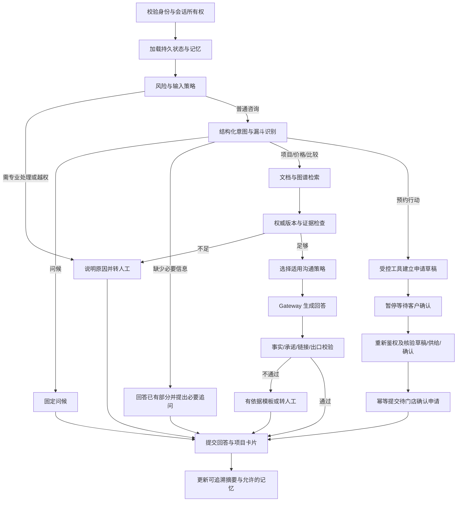

# LangGraph 咨询与预约流程

状态：咨询核心已实现；普通咨询自动答复，知识发布审核与个体医疗转人工独立。下文完整状态契约、预约/长期记忆/流式仍为后续设计，不代表当前已上线。

2026-10-12 聊天修正：新增PublicTopics，首个/当前主题保存有限项目key和来源run/message引用，读取时要求本线程已完成、允许外发的原用户消息，再按当前授权发布目录重新解析；不按检索结果猜原聊天主题。当前明确项目优先，比较指代保留双方，降级引用/卡片保持同一主题。流程问题优先使用当前有效consultation-process公开资料。首次主题回忆本地返回，有来源才回答；不建立跨线程长期记忆。

短期模型上下文仍有界：最多4条公开问题与3组公开问答，每答最多1200字符。问答来自已完成generated/evidence_fallback且无风险转接的运行，引用仍全部有效才外发；Gateway前再次验证来源，排除联系方式/个人医疗/业务原文。风险只在本地保存medical_pending类别标记，关联个人评估和短“那这个呢”继续转专业人员，显式公开流程可恢复；风险正文不进入模型/摘要/checkpoint。拒绝邀约保留为公开偏好标记，不是业务联系授权。

有限本地路由补充光子/光电等别名、明确否定评估表达、公开付款流程与实际付款动作区分；实际业务转接显示业务原因。无关编程在本地澄清且不作为公开历史外发。生成通常最多两段，一句话总结限制为一句；条件式“门店确认后才是已确认预约”不误当已执行，但实际完成声明仍拒绝。结构/原文引用失败可在30秒预算内再生成一次，重新走权限/来源和验证，不重试被拒绝的事实或承诺，不向用户返回失败草稿；再次失败只引用当前有效证据，比较可保留两条相关来源。元数据记录model_retry，无草稿/风险正文。最新实际验证见chat-quality-review.md和production-readiness.md。

## 状态契约

| 状态 | 字段与规则 |
| --- | --- |
| 运行 | schema_version、graph_version、run_id、thread_id、message_id、deadline、lease_token |
| 权限引用 | 服务端 tenant_id、visitor/customer 引用、scope_version；用户输入不得覆盖 |
| 消息 | 本地 message_refs、脱敏本轮问题、近期公开追问；限制长度与附件类型 |
| 意图 | domain、primary_intent、secondary_intents、funnel_stage、confidence、missing_slots、risk_reason |
| 上下文 | summary_version、source_message_ids、confirmed_preferences、unresolved_questions、intent_changes |
| 证据 | knowledge_id、version、source、scope、expiry、simulation 标识；只保存必要摘录 |
| 输出 | answer_draft、validated_answer、project_ids、evidence_refs、handoff_reason |
| 工具 | action_id、draft_ref、confirmation_ref、idempotency_key、authoritative_result_ref |
| 运维 | attempt_counts、error_class、dependency_status、trace_id |

不在 graph state 保存联系方式或医疗档案正文；业务 draft_ref 由受控工具解析。checkpoint 只恢复运行，不重授权限。

## 漏斗与节点

漏斗阶段为了解 → 明确需求 → 比较/顾虑 → 预约意愿 → 申请。服务阶段另存待确认/已确认/到店等业务状态。漏斗不是强制升级；支持直接问价、回退、切换项目、拒绝营销。风险与越权检测优先于销售策略。

意图节点采用有限枚举、结构校验与置信度，不接受自由生成路由。低置信度提出一项关键澄清；多意图先解决客户问题再邀请行动。以明确预约动词或客户按钮操作触发草稿，不能由“价格咨询”自动写入预约。

## 确认、中断和转人工

预约人机协同呈现在咨询消息中：识别客户意愿 → 输出有类型的预约意向卡 → 客户修改或补全必要信息 → 展示草稿快照并暂停等待明确确认 → 恢复核验 → 提交申请 → 对话内显示权威结果。页面上的预约按钮仅表达用户意愿并进入对话，不绕过这条流程。项目未确定可预约咨询；普通项目浏览不自动写业务。

前端不能靠自然语言答复含“预约”推断工具操作。M3 当前通过 BookingService 的最新意愿与权威状态渲染卡片；草稿绑定触发 run、门店、主体、政策/项目版本和快照摘要，旧卡不能恢复已替代动作。联系方式仅通过受控业务接口提交，不写入图、外部模型、消息、checkpoint 或 trace。结构化草稿、核验和确认是实际持久业务流程，当前没有新增 LangGraph interrupt 或 SSE confirmation_required 事件；不能把该规划事件当成现有接口。

interrupt 前仅建立可撤销草稿；恢复节点可能重放，写入必须独立幂等。确认凭证绑定草稿内容哈希、主体、门店、动作、有效期与明确操作；更换时间/项目后旧确认失效。拒绝则结束草稿，不创建申请。恢复必须检查凭据、供给、知识有效性及业务版本；不能只信任 Command(resume) 输入。

门店确认是独立业务事件，不使图持续阻塞到到店。人工转接创建持久化工单并说明等待状态；没有人工接入时明确“尚未接通”，不模拟已接通。人工超时不视为批准，不自动执行医疗或业务动作。

## 记忆与压缩

短期：PostgreSQL checkpoint 保存当前 thread 运行状态；消息正文单独存储并按权限读取。匿名凭据失效后不能凭 thread_id 找回。长期：应用 MemoryService 按租户、客户及可用范围读写，注册/核验并知情确认后才跨会话使用；LangGraph Store 适配该服务，不另建失控副本。

长期记录字段：key/value、source、source_ref、confirmed_at、consent_ref、scope、expires_at、supersedes、deleted_at。仅显式客户偏好进入长期记忆；推测、诊断、员工备注及模型总结不自动成为事实。匿名转客户需明确关联动作，禁止仅按手机号字符串合并。撤回/删除传播到消息、摘要、checkpoint、记忆及可删除追踪，并明确备份生命周期。

初始上下文预算：系统与工具 20%、近期对话及摘要 30%、证据 40%、输出预留 10%，具体值随模型实测。优先删除重复摘录和过期信息；压缩时保留否定、意向变化、未解答问题、来源与时间。摘要永远不是授权或医疗事实；客户更正覆盖旧偏好但保留必要历史。摘要失败沿用上一版本及近期消息，不丢弃未确认动作。

生成先形成经过校验的回答段再通过 SSE 发给客户端；风险检查前不外发原始 token。项目卡片来自目录接口，不由模型编造 URL。可流式显示进度事件，最终回答标记完整/未完成。具体流式分段体验在 M2 验证。

## M2 已实现与实测

LangGraph 1.2.14 实际节点为 classify → fixed/handoff/retrieve → generate → validate。有限本地规则识别了解、需求、比较、预约意愿和拒绝营销，风险优先、证据不足转人工。普通问题经过既有混合检索，Qwen 只接脱敏公开问题、最多四条公开追问及三条重新核验的公开证据。结构化段落校验来源 ID、连续原文引用、数字、联系方式、链接与禁用承诺；失败仅回有效证据摘录。

原始消息仅本地保存；自有 JSON checkpoint 不含原始输入、个人档案或凭据。读写恢复均验证 run 所有权和租约。已实测 END checkpoint 后提交失败恢复不重复生成；不是尚未实现的预约 interrupt。知识撤回、退出登录发生在生成途中时拒绝旧回答。waiting 工单明确人工未接通，visit_interest/submitted=false 不代表已预约。

短期记忆取最近六条允许外发已完成问题，给模型最多四条、每条 500 字符，摘要含来源/版本/意图/阶段及拒绝预约状态，拒绝偏好跨压缩窗口保留直到明确改变。该压缩为有界抽取，不是 LLM 摘要、完整 token 配额或跨 thread 长期记忆；后者须注册核验、客户同意、来源和撤回机制后实现。

节点元数据本地持久追踪，LangSmith 自动外发禁用。规则守卫和引用校验不等同于完整语义蕴含或医学安全证明，仍需对抗测试和真实知识审批。固定合成 HTTP 真实 Qwen 普通回答/关联追问、医疗转人工、幂等/历史/登出通过；M3 已接客户图文关联及本地模拟预约确认闭环，真实短信、门店处理、身份长期记忆和外部观测尚未完成。

M3 第二批的业务恢复由独立应用服务负责：发送前持久 unknown 核验记录，供应商未知不盲重发；确认同事务写申请、确认快照、事件/outbox、幂等与审计。每次重新核验身份、最新意愿、政策与项目，失败不以模型答复推断成功。页面历史意愿文案是消息发出时状态，当前申请独立查询；提交显示 pending_store_confirmation，不代表确认了时段或已接通人工。手机号核验不创建客户身份合并或跨线程记忆。

M4 首批门店确认/婉拒由 StaffBookingService 独立权限、版本和事务控制，图不接员工业务明文或号码，客户侧通过 booking 当前状态读取结果。门店只能确认客户已经确认的原期望时间，需员工核实接待能力并明确动作；失效政策/项目不能确认，改约要求新客户确认尚待实现。后台业务状态更新不会把人工工单标为已接通，也不改变历史模型答复为新的业务证明。

M4 第二批 BookingLifecycle 独立处理改约提案/客户接受或拒绝、客户取消和员工到店登记。图仍只识别预约意愿，业务操作不交给模型执行。客户本人接受当前有效提案后才改变时间；事件和独立确认快照保留原申请来源。预约操作无需重新触发模型意愿节点，也不自动关闭转人工工单或开启跨会话记忆。上述“改约待实现”是首批历史边界。

## 共情路径（2026-10-12）

新增 intent=support；本地 cue 选择当前有效的公开共情话术，不向 API/trace/checkpoint 暴露情绪类别。纯情绪 fixed，无项目/预约动作；混合问题先投影公开任务，生成已验证事实再添加本地开场。public_answer 只保存事实供关联追问，摘要仅保留暂停邀约和危机处理状态。危机优先、连续保持、否定安全声明不清除；个人临床判断转专业，不能借共情绕过。有限规则与数据范围见 [共情设计](empathy-design.md)。

## 固定编排的容器执行（2026-10-12）

LangGraph 不直接持有外部连接或业务写入：每轮在离线容器运行，RemoteStore/Reader/Gateway/Saver 通过有限 Broker 服务当前会话。原 plan/memory_snapshot 共享用于父子一致校验，已有路由/共情/事实/恢复保留。worker自身Linux计时器与父监督分别终止执行；最终trace增加sandbox节点与拒绝调用安全元数据。更多见 [运行时沙箱](runtime-sandbox.md)。
