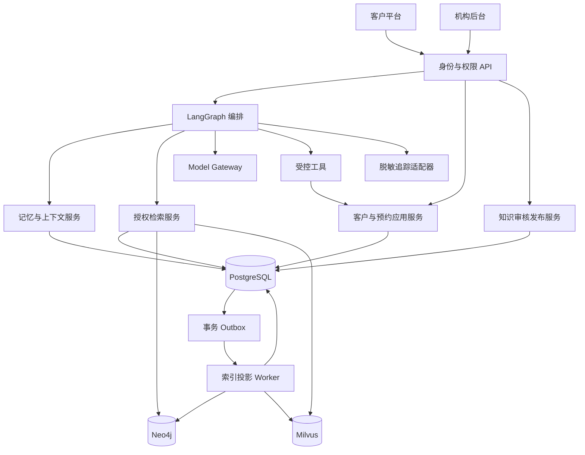

# 架构设计

状态：M1/M2、M3 客户咨询/预约申请、M4 预约生命周期和 M5 到店咨询及站内回访已实现。真实 Qwen 合成咨询及本地模拟业务闭环已验；主库340个发布/投影版本（含历史）、25条原医学待审；咨询新执行默认Docker运行时隔离。外部通知/CRM、真实短信账号、注册后长期记忆与生产运维未验收。下文未注明已实现的业务、SSE 和集群能力仍为设计。日期：2026-10-12。

聊天上下文修正：agent_memory沿用现有JSON存首个/当前项目key及原run/message引用，PostgresAgentStore按同一自有thread/已完成/用户允许外发重新解析来源；内存临时_topic_sources不回写，不新增迁移或客户权限。PublicTopics按当前有效目录匹配，先处理本轮明确主题，再有限公开历史。Gateway只接当前公开问题/批准证据、最多4条公开问题/3组有有效来源的公开问答和拒绝邀约公开偏好；医疗风险类别留在本地，个人医疗/身份/业务记录不入出口。来源撤回时历史问答排除，外发前再次验证引用；新会话不继承旧主题。内容格式/引用一次预算重试不绕过审查，未验证草稿不提交或checkpoint。工程回归和真实合成回复验收另记录，不扩医学知识批准。

演示资料独立边界：版本化 backend/data/demo_materials.json 是只读产品讲解资料。API→DemoMaterials应用服务→Repository Protocol，重用精确员工customer_read门店授权/读取审计，再按public_code投影单门店资料；机构/虚构供应商为包级非客户内容。生产或关闭模拟、非模拟门店拒绝。前端仅服务器返回的当前店JSON可导出，身份/门店变化清空旧视图和导出数据。没有业务写入、追加账号/grants、知识批准/发布、向量图谱投影或模型出口；不能把模拟独立复核当作实际医学或供应商验收。资料与故障模拟器分开。

## M5 第二批站内回访实际边界

012 新增 followup_task/event/command，完整关联租户、门店、访客、到店档案与来源意向版本。API 调用 Followups 应用服务，服务通过 Repository Protocol 使用固定SQL访问 PostgreSQL，不接 Agent、模型、短信或CRM。计划与事件使用既有持久 Fernet/HMAC 密钥加密和校验；审计只保存动作与资源引用，不保存正文、号码或医疗记录。现有 customer_read/manage 足够，不新增员工权限或重置种子。

顾问只能从当前已获本人确认的意向提出计划，状态 awaiting_confirmation；接受时再次核验来源仍为当前已确认版本、有效项目和创建顾问的精确门店权限，计划时间必须尚未经过。只有原访客本人可接受并变为 scheduled；拒绝变为 declined、取消变为 cancelled，均暂停此档案的新邀请。员工不能恢复暂停。本人 resume 只清除暂停标记，旧计划保持终态，新计划仍需独立同意。反馈可提前提交，completed 仅表示客户反馈已保存，不证明人工回复或外部通知送达。已接受计划保留来源，后续意向更新不会改写旧计划，反馈/取消仍可执行。

同档案最多一个未终结计划；所有写入按档案→任务顺序加锁，原请求键先持久核实，状态/版本/事件/幂等/审计同事务提交。重放重新鉴权并返回当前任务，不能复活旧状态或以旧确认同意新计划。列表读取不持有多档案写锁，历史限制到已读取版本，避免将后续事件混入旧状态。未知结果仅保留不可变原请求核实。客户读取只含公开计划、本人处理与反馈，内部 note 事件和员工取消备注在服务端排除；后台使用掩码号码与独立审计读取。

后台队列/候选档案按25条分页，最大100；客户每预约显示最近20项，单档案最多200项任务、单任务最多200个版本，是本地工程防滥用边界，后续正式保留/归档策略另验。站内确认不授予电话/短信联系同意、治疗或合同同意，也不构成注册/跨设备身份合并。真实SMS、通知Worker、CRM、人工接待与生产恢复仍为缺项。

## M4 首批门店运营实际边界

009 增量扩展独立预约权限、appointment.version/confirmed_at/decision_reason/updated_at、事件版本/请求引用及 staff_booking_idempotency。confirmed_at 为门店确认的到店时间；实际操作时刻为事件 occurred_at。StaffBookingService 依赖 Repository Protocol，重新校验并锁定有效员工会话、租户、门店和明确权限，随后锁申请；新接待账号不会获得知识权限，知识目录读取也不再把任意门店 grant 当知识权限。平台管理员没有默认客户权限。

分页队列直接查询权威 PostgreSQL，后台工作台使用真实状态计数；读取队列/详情及单独完整联系号码查看均审计，无明文号码进入审计/模型。确认/婉拒要求明确动作、期望版本和持久原请求键；同事务写状态、事件、幂等和审计。并发只能有一次状态变更；未知结果保留原键核实，重放仍重新鉴权。确认重新核验政策/项目并只接受客户已确认的原时间；过期/失效拒绝，变更需新的客户确认。婉拒必须选择有限公开原因，不自动执行到店、合同或项目确认。

客户预约记录独立读取当前状态、门店确认时间和公开婉拒原因；不用历史 Agent 文案推断业务成功。通知/CRM outbox 处理尚未接入，后台直接查询不依赖该 outbox；不能把队列可见视为已发送通知。真实排班/容量由授权员工人工核实，改约/取消/到店及客户档案属于后续。

## 技术与模块边界

2026-10-12 演示咨询补齐：`demo_consultation.json`通过既有版本/独立审核/outbox链路替换占位目录，新版本沿用项目key。`demo_medical_education`默认为false，且只允许非生产显式模拟；guidance.review_scope=demo_education须有public audience、非合成公开来源URL和日期。审核/publish、worker eligible、客户evidence使用相同范围，要求知识/审核/租户/门店均模拟，作者与审核者不同，复核记录明确模拟。关闭时证据立即拒绝；生产启动拒绝该开关，没有替代真实资质或医学审核路径。原医学待审不自动批准。API增加simulated/disclosure与证据review_scope，前端集中展示演示说明，正文不再每轮重复长声明。普通项目收费追问关联当前主题；一般风险科普与个人症状分开，个人正文仍本地处理。

采用模块化单体：Python/FastAPI 应用服务、LangGraph 编排、PostgreSQL 业务权威与 checkpoint、Milvus 文档向量索引、Neo4j 审核关系投影；客户和员工前端由用户指定为 Vue 3/TypeScript。frontend/customer 与 frontend/admin 是独立 Vite 应用、独立构建产物，frontend npm workspace 统一锁定依赖；没有重复拷贝客户素材，也未提前抽取共享 UI 包。服务端具体依赖版本已锁定。历史 pgvector 迁移不改写，当前运行链路经 VectorStore Protocol 连接 Milvus。

API 调用应用服务；应用服务通过 Protocol 访问模型、检索、图谱、验证与通知适配器。Agent 不执行任意 SQL/Cypher，不接受用户指定工具名称与参数直通执行。

## 身份、数据与外部出口

匿名访客凭据由服务端创建并持久化；浏览器使用安全 HttpOnly cookie。凭据限定租户及入口门店，跨门店浏览只读明确允许公开的目录；选择预约门店时服务端校验供给并建立限定授权，禁止客户端修改 scope。thread_id 仅是资源 ID，读取、发送、恢复均验证所有权。访客不拥有员工角色。

员工必须拥有明确门店授权。客户记录、会话、记忆、预约与查询均带租户边界；即使 UUID 难猜也必须鉴权。前端不直接连接数据库。开发身份与故障模拟器仅显式开发模式；生产错误启用时启动失败。

Qwen 只能经 Gateway；延续已授权国内端点与模型配置作为待实测基线，不从旧仓库恢复密钥。实际咨询出口仅包含脱敏当前问题、必要公开知识与脱敏相关追问；不外发身份、联系方式、预约、业务记录、内部备注或医疗档案。检索与意图节点也服从同一出口策略。原始消息仅在本地权限范围保存。

LLM_* 固定中国 HTTPS 地址及 396 个知识/合成摘要授权快照已生效，未来不自动扩展。实际公开咨询另有既有用户授权，由 QwenConsultationGateway 过滤并脱敏当前问题及必要公开追问，只携带重新核验的公开证据。身份、个人医疗和业务记录本地转人工，不进入模型上下文；医学仍待审。真实 Qwen 多轮合成咨询及客户页面联调已通过。

## 一致性与恢复

知识版本、审核、发布范围及有效期在 PostgreSQL。发布事务写 Outbox；Worker 幂等更新向量/Neo4j 投影并记录版本及失败。投影未就绪不激活新发布版本；撤回立即在权威层拒绝旧证据，投影清理异步执行。检索及输出提交前二次检查权威版本、范围和有效性。

Milvus 使用 256 维 HNSW/COSINE、Strong 一致性、独立集合范围读写账号；文档带 tenant/store/version/hash/model/audience/有效期/模拟标识。检索先取得 PostgreSQL 允许的版本，再分批构造固定过滤表达式；客户端不能指定集合或表达式。Upsert 前写持久 unknown 回执；超时后先 Strong 查询对账，存在且元数据一致则复用，查询失败不盲目重写，冲突拒绝。最终就绪以 PostgreSQL 内容摘要、范围、租约和权威版本复核为准。

预约事务持久化客户确认、预约申请、审计、幂等结果与 Outbox。图 checkpoint 不充当业务事务。业务已写但 checkpoint 未保存时，重放通过幂等结果恢复；结果未知先查询或对账。客户收到成功前必须有权威记录。

持久化同一会话运行锁/租约及 fencing token，超时运行不能覆盖新状态。新消息使用客户端 message_id 去重。图运行和 SSE 连接生命周期分开，断连不自动重做业务写入。采用应用自有稳定事件协议，避免前端绑定 LangGraph 内部事件版本。

## 失败策略（已实现边界与后续设计）

单轮预算 30 秒；模型单次 12 秒、最多 2 次尝试；检索单次 3 秒、最多 2 次尝试，所有步骤共享预算。连接错误、429、暂时性 5xx 可退避重试；400/401/403、校验拒绝不重试。尊重 Retry-After，超过预算直接降级。中途流式输出失败不拼接第二次生成；显示未完成状态并允许客户重试。业务操作使用独立幂等键。

依赖分别熔断：60 秒内至少 10 次调用且失败率达 50% 则打开 30 秒，半开只允许 1 个探测。避免 SDK 和图节点叠加重试。全实例统计与限流共享状态接口，第一版不声称已实现集群熔断。

向量或 Neo4j 故障：只有有效证据足以支撑时才降级回答；模型故障可提供已发布的固定 FAQ/人工入口；数据库故障停止业务写入，不以内存假成功。追踪出口故障不阻断咨询；本地业务审计写入失败则不执行预约写入。

## 追踪与后续容量

已实现请求 request_id、持久 run_id，以及节点名/耗时/安全结果分类的本地 trace；原始消息仅存本地业务表。图运行显式 tracing_context(enabled=False)，禁用 LangSmith SDK 自动外发。全链路关联、token/成本指标和外部 LangSmith adapter 尚未实现；外部账户、地域与合同待确认。统一 trace_id 和完整观测为后续设计。

第一版不设 RPS 达标承诺。保留无状态 API、外置状态、连接池、后台任务、分页、资源上限及限流接口；不要用进程内唯一状态或无界队列。之后确定容量目标，再实测扩容、背压和独立 Worker。

技术依据（2026-10-11 查阅）：[LangGraph 持久化](https://docs.langchain.com/oss/python/langgraph/persistence)、[中断与恢复](https://docs.langchain.com/oss/python/langgraph/interrupts)、[LangSmith 敏感信息控制](https://docs.langchain.com/langsmith/mask-inputs-outputs)。本项目的鉴权、幂等及出口限制是应用层设计，不能由框架 checkpoint 替代。

## M2 咨询后端实际实现范围

应用依赖 AgentStore / AnswerGateway / EvidenceReader Protocol。PostgreSQL adapter 用固定 SQL；图没有任意工具或查询。005/006 持久化消息、run、JSON checkpoint、pending writes、短期摘要、工单与元数据 trace。checkpoint 绑定 run_id，每次访问验证访客/门店/会话/租约，不使用可执行反序列化。LangGraph pending writes 可先于父 checkpoint 到达，006 改为 run 外键支持此顺序。

同步消息请求提交后返回完整结果，模型调用期间不持有业务数据库事务；没有 SSE 或后台调度。模型每次最多 12 秒/两次，调用前检查共享 30 秒剩余预算；图谱/向量读取超时，图谱 SDK 重试关闭。chat 与 embedding 的独立熔断在进程内共享并限制半开探测；全轮硬取消、数据库总预算和集群协调未实现。上述完整流式/容量策略仍为规划。

message_id 在 thread 内去重；同会话串行，90 秒租约与 fencing。失败/到期原键可恢复 checkpoint，旧租约不能写入。每节点和最终提交重新校验权限，最终回答/工单/摘要/幂等结果/审计同事务。模型失败或回答校验拒绝仅返回有效证据摘录；重放/历史也复核撤回证据。短期摘要保留来源和拒绝预约状态，不提取医疗事实、不跨会话。预约 action 仅表达意愿，工单未接通，没有真实业务写入。

## M3 客户应用与目录实际边界

Vue 客户应用仅调用同源 API；认证为服务端持久 HttpOnly 访客 Cookie，随机 CSRF 由 current 接口校验/轮换并通过辅助可读 Cookie 与响应提供。CSRF 不是身份凭据。首次匿名接入限公开门店，替换已有会话仍要求旧 CSRF；跨门店显式重建访客，不对原 thread 放宽范围。浏览器仅保留 visitor/thread 引用，消息在 PostgreSQL；刷新及窗口重新聚焦重新读取身份、历史与目录，失效时清理旧来源与项目。

CatalogService 依赖 EvidenceReader Protocol，使用权威公开证据和其目录实体，读取元数据后再次复核。图片由有限本地资产注册映射，详情路径由版本 ID 构建；不是 LLM URL 或医学推荐工具。公开门店列表仅最小展示字段，目录和客户数据仍需访客门店授权。失败时不注入示例目录或假回答。生产反向代理/TLS、真实资料及容量仍须验收。

## M3 预约申请实际边界

BookingService 依赖 Repository Protocol，BookingApplication 通过 SmsGateway Protocol 调用短信适配器。LangGraph 只触发 visit_interest 意愿；结构化卡片输入是本地业务数据，不进入模型/checkpoint。业务写入通过独立 HTTP 明确动作执行，没有任意 Agent 工具直通。预约前再次校验有效访客、门店、自有线程、最新明确预约意愿；拒绝/医疗或未完成新问题阻断旧提案。

007 持久化加密草稿、contact_verification、确认快照、appointment、事件、独立 booking_outbox 与幂等；008 为事件/outbox 增量补齐租户门店访客外键，已应用迁移不改写。Fernet 加密业务快照和验证码，HMAC 摘要绑定手机号/验证码/请求内容；页面只读脱敏号码，密钥需持久保管/备份，密钥轮换与删除仍待运维流程。

预约政策必须为指定 key 的已批准、已发布、有效且投影一致的公开 operational 版本，可选目录同样复核。草稿绑定政策/项目版本、期望时间、门店与触发运行；30 分钟过期，修改创建新草稿并使旧稿不可提交。短信需客户发送同意，5 分钟验证码、最多 5 次失败、15 分钟核验凭证；手机号/访客共享 60 秒间隔和 15 分钟最多三次限制。发送前 unknown 回执及请求键先提交，外部调用不占数据库事务；同键不重发，未过期 unknown 阻断新发送，收到验证码可核验。没有供应商自动重试或假成功。

确认事务锁定认证/门店/会话，核验最新意愿、草稿/政策/项目/联系方式及明确勾选和固定确认文案；确认记录含时间、方式、证据请求 ID 与快照哈希。确认、待门店确认申请、事件、outbox、凭证消费、审计和幂等同事务提交；审计失败全部回滚。同键异文拒绝，并发同键只一条申请，同一触发意愿不能产生第二份申请。未知提交可查询当前权威状态或原键恢复，不以客户端状态宣称成功。

开发模拟短信需明确配置并显著标识；生产启动要求真实 Aliyun 适配器、数据密钥与短信凭据/签名/模板，拒绝模拟或关闭核验。真实供应商需机构账号实测，当前仅 MockTransport 与官方签名向量通过。上述为 M3 批次边界，门店操作后来在 M4 实现；CRM/通知 outbox Worker、真实排班与注册身份合并仍未实现，人工工单仍等待。

## M4 预约生命周期实际边界

API→StaffBookingService / BookingLifecycle→Repository Protocol。员工必须有精确门店 appointment_read/manage grants，联系号码另需 contact；不默认授予平台管理员。访客 Cookie/CSRF、自有线程、预约所有者及活动门店每次重验。所有写入在 PostgreSQL 事务内锁定认证/预约，带 expected_version，幂等请求键与内容摘要先于版本冲突判断；重放也重新鉴权，返回当前状态且不回退后续状态。

门店确认原时间与带原因婉拒由009实现；010新增 arrived_at、booking_change_proposal、booking_action_confirmation。提案保留原状态与时间，只增加版本；有效30分钟，新提案替代旧提案。接受时校验提案版本/摘要/期限、当前政策与可选项目及提案员工仍有权限，客户按钮明确确认后才更新到店时间。拒绝保持原状态/时间；客户取消仅待确认或已确认预约，使活动提案失效。员工到店登记要求已确认、无未回应有效提案、身份/实际到店核实和明确按钮动作。

每次生命周期变更的加密快照、确认文案/时间/方式/请求ID、事件、幂等和审计同事务提交；原始客户申请快照不改写。改约/取消不是 Agent 模型工具，结构化业务信息不会发送给 Qwen 或进入可外发 checkpoint。没有排班锁定、CRM 写入、通知 Worker、付费取消规则或自动身份合并。浏览器刷新读取权威状态，模拟资料不绕过授权/确认。

## M5 首批到店咨询实际边界

API → ConsultationCases → Repository Protocol；业务为固定 SQL 事务，不暴露 Agent 工具。011 新增 consultation_case / consultation_revision / consultation_decision / consultation_command 及完整 tenant/store/visitor 复合外键。每份已到店预约最多一份咨询档案，不凭手机号合并身份；创建保留原客户加密申请快照。档案不是注册账户，也不建立跨设备长期记忆。

员工读取要求精确门店 customer_read，写入另需 customer_manage；创建还需 appointment_read。既有接待、知识作者/审核员及平台管理员不自动得到客户资料权限。新增开发模拟 demo-consultant 仅上海店 appointment_read/customer_read/customer_manage，没有预约处理、完整联系方式或知识权限。重复 seed 不恢复被撤回的权限或重置密码，生产不允许开发模拟身份。

意向变更追加加密快照（称呼、咨询意向、公开目录版本/标题、客户可见变更说明），版本递增，上限200；原申请与历史版本不改写。客户读写要求活动访客 Cookie、自有预约/线程/门店，写入要求 CSRF。接受/拒绝绑定当前版本、快照 HMAC、明确勾选及固定文案；每版本只记录一次客户处理，确认包含服务端时间、customer_button 方式和请求证据。接受再次校验目录发布/独立审核/有效期/投影及记录顾问仍有明确门店客户权限，拒绝不要求撤回的目录重新有效。历史标题仅表示当时记录，不是当前有效推荐。

认证与门店锁先于写入，顾问修改和客户确认统一锁档案再锁来源预约。持久请求键/摘要与 PostgreSQL advisory lock 防止并发重复；同键异内容拒绝，重放先鉴权后返回最新档案，不用旧请求确认新版本。版本、快照、处理记录、幂等和审计同事务，审计失败全部回滚。前端未知结果保留不可变原请求，旧门店/访客响应被丢弃；不自动更换请求键或补勾选。

列表/详情只返回掩码号码及授权咨询版本，业务快照不进入 Qwen、embedding、checkpoint 或外发 trace。普通问答仍通过原模型网关，本批没有扩大出口。客户确认仅针对咨询意向，不代表个人医疗判断、治疗同意、收费或正式合同。尚无回访任务、CRM、通知 Worker、注册身份核验、资料删除/保留与密钥轮换运维验收。

## 本地共情层（2026-10-12）

LangGraph 在公开事实生成/固定回应之后增加有条件 support 节点。话术来自授权门店当前有效公开知识，提交时再次校验证据；事实与完整共情 answer 分开保存。纯情绪不初始化外部客户端，混合问题仅向 Model Gateway 传项目和公开任务，情绪/关系原话不外发。本人 support 消息的项目引用仅允许本线程本地解析，临床/越权来源仍拒绝；见 [共情设计](empathy-design.md)。

## 实际运行时隔离（2026-10-12）

API send factory 默认 SandboxedConsultationAgent；父进程 claim 与权限 Broker 绑定当前 actor/run/lease，离线非 root Docker 执行固定 LangGraph，受限 JSON IPC 请求授权服务，无数据库/业务/模型凭据。最终父进程重新校验路由、答案、证据、动作和记忆并原子提交。持久 ScopedCheckpointSaver 通过 Broker 保留，超时/异常失败封闭，原键恢复；生产禁止 inprocess。每实例并发2，512 MiB/1CPU/64PID和45秒沙箱预算，尚非集群容量/SLA或独立内核。细节见 [运行时沙箱](runtime-sandbox.md)。
