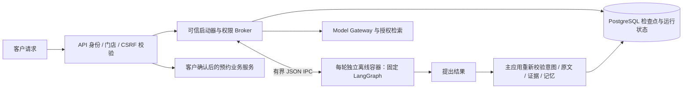

# 咨询 Agent 运行时沙箱与面试说明

日期：2026-10-12。本里程碑实现固定 LangGraph 编排的 Docker 运行时隔离；代码默认走隔离路径，生产拒绝 inprocess。工程回归、真实容器边界与真实模型合成对话的实际结果在本文末尾记录。它不是面向客户开放的任意 Python/Shell 执行器。

## 为什么需要、隔离什么

咨询同时涉及第三方 SDK、模型响应、客户自由输入和知识检索。应用权限控制只能约束业务操作，无法限制异常执行进程的内存、进程数或文件访问。因此为每轮新执行创建短生命周期、独立进程/文件/网络空间的容器，保护主 API 和其他会话。历史读取及已完成请求重放不重复启动容器。

容器只运行固定镜像中的 LangGraph、意图/情绪识别、上下文与答案组合。PostgreSQL、检索适配器、Model Gateway、密钥和业务服务留在可信应用侧；容器通过 stdin/stdout 的有限 JSON 协议请求服务。没有传数据库地址、认证凭据、真实 lease token、API key、手机号核验密钥或员工权限。



这不将预约写入、知识审核或模型出口授权交给模型。沙箱只表达已校验的 visit_interest；实际预约仍走独立 API 的身份、门店、来源、联系方式核验、本人确认、幂等和审计。

## 在哪里实现

| 文件 | 核心职责 |
| --- | --- |
| [sandbox_runtime.py](../backend/app/sandbox_runtime.py) | DockerRuntime：固定镜像、并发准入、Docker 安全参数、超时监督、异常退出处理与销毁；SandboxedConsultationAgent 接现有 send/claim/finish |
| [sandbox_broker.py](../backend/app/sandbox_broker.py) | Broker：白名单操作、固定 actor/run/lease、每次鉴权、当前证据、父进程模型请求与最终提交校验 |
| [sandbox_worker.py](../backend/app/sandbox_worker.py) | RemoteStore/Reader/Gateway/Saver：固定 LangGraph 在无网络、无凭据容器中运行；自身 Linux 计时器；不直接提交最终结果 |
| [sandbox_wire.py](../backend/app/sandbox_wire.py) | 版本化任务与有界 JSON：拒绝额外字段、非 JSON/NaN/任意对象/深度与帧超限，无 pickle 或可执行反序列化 |
| [api.py](../backend/app/api.py) / [config.py](../backend/app/config.py) | lifespan 接入默认隔离 factory，启动失败封闭、就绪检查 Docker；生产禁止进程内运行 |
| [sandbox/Dockerfile](../backend/sandbox/Dockerfile) / [依赖锁](../backend/sandbox/requirements.lock) | 固定非 root 镜像，47 项锁定运行依赖；构建上下文严格排除 dotenv、runtime、测试、客户记录和宿主目录 |
| [test_sandbox.py](../backend/tests/test_sandbox.py) | 白名单/范围/伪造输出拒绝，真实 Docker + 隔离 PostgreSQL 问答、共情、检查点和原键恢复 |
| [sandbox_acceptance.py](../backend/scripts/sandbox_acceptance.py) | 独立故障镜像验证文件/网络/资源限制、超时/内存/协议故障和容器自身退出计时器 |
| [sandbox_smoke.py](../backend/scripts/sandbox_smoke.py) | localhost 真实 API/Qwen 固定合成四轮，核对 sandbox trace、重放、历史和退出 |

consultation_agent.py 仅把原上下文准备和短期摘要构造提取为 plan/memory_snapshot，供父子双方共同校验；节点逻辑沿用。已注入远程依赖时不构造数据库/图谱/模型客户端。Milvus SDK 改在适配器实际调用处加载，使离线编排镜像不需要 Milvus、pandas 等包；主应用依赖锁与数据不改变。

## 实际限制与协议

| 边界 | 默认参数或规则 |
| --- | --- |
| 网络 | `--network=none`，仅 loopback；无端口发布；所有检索/模型请求由可信 Broker 校验后执行 |
| 文件 | 镜像根文件系统只读，无宿主/源码/Docker socket 挂载；`/tmp` 为 8 MiB tmpfs，noexec/nosuid/nodev |
| 身份与内核权限 | UID/GID 65532，cap-drop=ALL，no-new-privileges，Docker 默认 seccomp；沙箱不使用 unconfined |
| 内存 / CPU / 进程 | 512 MiB，swap 总额同内存，1 核 CPU 配额，64 个进程，128 个文件描述符 |
| 执行时间 | 启动器默认 45 秒执行预算；子进程另设 Linux 自退出计时器，父进程崩溃后仍会退出；最大配置60秒 |
| 并发 | 每 API 实例最多2轮沙箱新执行，饱和返回 sandbox_busy，不无限排队；不是集群吞吐承诺 |
| IPC | 每帧2 MiB，总24 MiB，最多128次调用，JSON深度32；顺序号校验，无 Shell、SQL、URL、模块名或函数直通 |
| 持久化 | 每次调用绑定父进程已验证 actor/run/lease；检查点仍保存权威 PG，最终答案须容器成功退出并再验后提交 |
| Broker 数据库调用 | 连接超时5秒、SQL statement_timeout=5秒、lock_timeout=2秒，连接级设置，不改变数据库角色/全局配置 |
| 日志 | Docker log-driver=none；主服务 trace 只存节点/耗时/安全错误码，不记录 IPC 正文、模型原文或凭据 |

允许的协议操作只有 scope.check/context、trace、evidence.list/details、retrieval.search、model.answer、checkpoint.get/put/writes。Actor、租户、门店、run 和 lease 均由父进程绑定，不能由协议指定。模型问题必须对应当前本地公开问题；历史/证据正文从主应用重建，拒绝 worker 注入的历史和任意证据。模型草稿在父进程也执行 validate_draft；最终结果再核对范围、路由、批准原文/模型验证结果、动作、短期摘要与外发标记，证据元数据由父进程重建。拒绝调用有本地元数据 trace，撤权后不能继续记录或提交。

失败不会回退到进程内执行或生成假成功。内存超限/异常退出/协议拒绝/超时记录 failed，无 assistant 成功消息；原键可按既有90秒租约/fencing和持久检查点恢复。纯情绪、医疗转接与问候也在隔离编排内运行，但不调用外部模型。已完成同键重放返回权威结果且再验来源，不再运行容器。

45秒是沙箱执行预算，不是全 HTTP 请求 SLA：前置授权/上下文、可信 Broker 的在途网络/数据库调用、清理与最终事务另有各自预算。容器在超时后被移除，即使在途服务稍后返回也不提交；对模型/数据库调用不作可瞬间撤销的承诺。

参数依据 [Docker run 官方文档](https://docs.docker.com/reference/cli/docker/container/run/)；生产沙箱使用默认 seccomp。原 compose.agent-dev.yml 的 Milvus 开发服务未在本批改动，它的 unconfined 配置不是该沙箱策略。

## 本地启动与复现

在 backend 目录执行，先保持现有 PG/Neo4j/Milvus 和已应用012迁移：

```powershell
docker build -f sandbox/Dockerfile -t medical-consultation-sandbox:local .
..\.venv\Scripts\python.exe -u -X utf8 -m uvicorn app.main:app --host 127.0.0.1 --port 8001 --no-access-log
```

默认 MA_AGENT_RUNTIME=docker；本机无需修改已有 .env。API启动解析带 v1 镜像标识的固定镜像ID，后续运行 `--pull=never`，不接受请求/模型指定镜像。代码改动需要重新构建镜像并重启API。MA_SANDBOX_IMAGE可由部署人员设置可信镜像引用；当前是启动时固定ID，不是镜像签名/供应链验收。开发/测试可显式 MA_AGENT_RUNTIME=inprocess，生产配置必须拒绝此值；专项测试 fixture 明确选择进程内测试，真实 Docker 专项另开启。

```powershell
$env:MA_TEST_SANDBOX_DOCKER = '1'
..\.venv\Scripts\python.exe -X utf8 -m scripts.verify tests/test_sandbox.py
Remove-Item Env:\MA_TEST_SANDBOX_DOCKER
docker build -f sandbox/probe.Dockerfile -t medical-consultation-sandbox-probe:local .
..\.venv\Scripts\python.exe -X utf8 -m scripts.sandbox_acceptance
..\.venv\Scripts\python.exe -X utf8 -m scripts.sandbox_smoke
```

verify 只重置 ma_m1_test；边界测试不访问业务库或模型。probe.py/probe.Dockerfile 是单独验收镜像，业务 worker 没有故障模式。smoke 使用独立匿名凭据和固定合成输入，可能调用已授权的公开问题/Qwen，不提交预约、不注销浏览器访客。health/ready 返回 agent_runtime=docker；请求 run trace 含 sandbox/completed。

## 面试可以这样讲

> 我们用 LangGraph 编排医美咨询，并实现每轮独立的 Docker 运行时沙箱。容器无网络、无宿主挂载、无密钥，使用非 root、只读根文件系统和资源配额。数据库与 Model Gateway 留在可信服务侧，通过固定白名单 JSON 协议为当前访客和运行提供能力。模型、用户或沙箱都不能指定 SQL、Shell、租户或预约写入。
>
> 沙箱输出不能直接成为业务结果。主应用会重新校验当前身份、证据和答案，再将运行结果、摘要、审计等原子提交到 PostgreSQL。超时或进程异常时销毁容器并保留原请求键/检查点，恢复时重新鉴权。我们实际测过断网、文件写拒绝、内存/PID限制、超时和断点恢复。

常见追问：

- 为什么仍需要权限校验？沙箱限制进程可接触的资源，租户/门店授权与本人确认决定业务是否允许，两层分别生效。
- LangGraph是否本身提供沙箱？本项目使用 LangGraph 编排，运行时隔离由 DockerRuntime 和 Broker 另外实现。
- 无网络怎么调用模型？容器只能提出当前任务的固定请求，主应用的 Model Gateway 处理外部调用和隐私/来源校验。
- 每轮启动容器的成本？有额外冷启动成本，目前限制并发新执行，不建立共享客户状态的容器池；容量/池化需另压测，不能声称100 RPS。
- 能否运行客户提供的Python？没有这个入口。任意不可信代码需要更强威胁模型及额外运行时评估，不能把这套固定编排隔离直接包装成通用代码执行平台。

## 限制与待验收

这是 Docker 容器隔离，不是已接入 gVisor/微虚拟机或完全独立内核。可信启动器拥有 Docker控制权限；生产需部署到受控独立运行节点/最小权限启动服务，评估 rootless/镜像签名/内核与镜像安全更新。参见 [Docker 安全说明](https://docs.docker.com/engine/security/)及 [rootless](https://docs.docker.com/engine/security/rootless/)。不把 Docker 视为没有逃逸风险的安全证明。

启动器和子进程都有时限，但 Docker daemon 故障时移除指令可能失败；记录 cleanup pending 元数据，需运维按 medical.consultation.sandbox=1 标签核实遗留容器。尚无集群级配额、跨实例准入或自动对账巡检。原医学/真实资质/供应商、备份恢复与云部署要求不变，本批不扩大医学批准、业务权限或模型出口。

## 实测记录

结果按实际批次追加，不将测试数量相加为全量回归或将合成验收描述为真实客户/生产容量认证。

最终实测：受影响整批162 passed/354.90s之后，最终沙箱专项 **28 passed/90.21s**（MA_TEST_SANDBOX_DOCKER=1，无跳过）；Ruff检查/格式84文件、mypy39源文件通过。前端未改动，不重复构建；不是最终全后端回归。最终真实故障验收16项边界全部true、异常/超大JSON拒绝、OOM资源退出、10秒父监督超时、未知操作拒绝和子自身计时器全部通过；自身计时器 exit142/14.45s（含镜像启动/导入，不是精确10秒全HTTP SLA），故障结束 remaining_containers=[]。原始runtime/sandbox-boundary-report.json保留。两次清理同时发生的Docker --rm/rm竞争曾输出cleanup pending；只读元数据确认“removal ... is already in progress”，增加不存在确认及安全日志专项，最终仍可能在后台移除尚未完成时记录pending，故障结束和HTTP后均确认无遗留；不把瞬时pending伪装成已发现daemon故障或保证所有故障下清理。

当前本地API已经启用默认Docker路径，PID14340/session57530，迁移012；仅重启已核实8001进程，5173/5175及5174保持。固定独立合成访客真实Qwen/API四轮：问候fixed、预算担忧+补水价格generated、关联步骤generated、暂停fixed；全部HTTP200、同键重放一致、每轮仅1条sandbox/completed trace、历史8消息及退出后401通过，均无预约action或业务提交。每轮沙箱节点5.452/14.467/10.328/5.422秒，包含冷启动/IPC/检索或模型，是实际小集耗时，不是生产SLA/容量。runtime/sandbox-chat-report.json有完整合成回复和元数据，LLM仅当前公开问题/批准证据；低落/临床/身份原文不外发。

实际运行镜像ID：sha256:cf601dd0539f0a63bf24028f10a14601222a31f66a3dc64b30c168b457074b64；独立故障镜像：sha256:13b482db70047361ddde39e5be7f4c9b95b82f83a8a2bcc4e381e3094fe0d17f。代码或配置改变后需重建与重启；当前镜像和启动器使用同一冻结代码。用户.env/LLM配置、知识批准/版本、租户门店授权、客户确认和业务密钥未改动；没有云部署、短信/CRM、提交推送。Git仍main/源码未跟踪，.env/种子与runtime捕获忽略。最终17份Markdown本地链接无缺失。后续仍需生产受控启动器/镜像供应链、daemon故障自动对账、跨实例配额与容量工程；医学/真实资质/供应商、备份恢复、云服务器信息未由本批替代。
